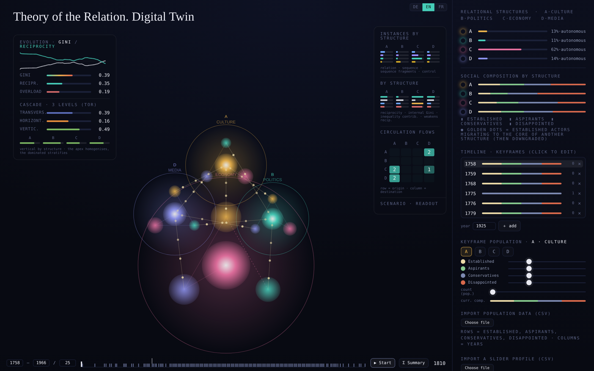

#+TITLE: Theory of the Relation — Digital Twin
#+OPTIONS: toc:nil num:nil ^:nil
#+LANGUAGE: en

A stand-alone web application (HTML/JavaScript, Canvas graphics) that simulates the *Theory of the Relation*. It represents four mutually influencing relational structures — *Culture (A), Politics (B), Economy (C), Media (D)* — each articulated into sequences and four actor categories, and it lets you feed in real data to observe the mutual influence of social orders, the unequal circulation of actors, the mediation and control instances, and the inequalities that arise.

#+CAPTION: The twin in data mode (v64): the cohort of 163 working-class autobiographers with its mediation and control instances, around 1810. The economy (C) dominates; culture (A), politics (B) and media (D) are its satellites.

*Theoretical basis:* Christian Papilloud & Eva-Maria Schultze, /Skizze einer Theorie der Relation/, Springer VS, Wiesbaden 2022 (ISBN 978-3-658-37922-3).

* Run it

The twin is a single, self-contained file: =tr-twin.html=.

- *Locally:* download or clone the repository and open =tr-twin.html= in any modern browser. No build step, no server, no dependencies.
- *Online (GitHub Pages):* enable Pages (Settings → Pages → deploy from branch, root =/=); =index.html= redirects to =tr-twin.html=.

The interface switches between *English, German, and French* (the DE·EN·FR pill, top right).

Since version 68 a run is prepared in a *run file* (examples in =runs/=): it names the theory profiles or the contract table, the time axis and the seeds. In the interface, /Choose run file and data…/ loads it with the files it names, /▶ Compute/ computes it and opens the results, /▶ Start/ replays it. The same run computes from a terminal, with the same results ([[file:techdocs/04-headless-runs.org][document 4]]; Node.js and, once, =npm install=):

#+begin_src sh
node run.js runs/compare_parsons_luhmann.csv
#+end_src

* Two modes

The twin does two different things, and the repository is split accordingly.

- *[[file:simulation-mode/README.org][Simulation mode]]* — a cursor profile encodes a theoretical framework: how it construes
  circulation, mediation, reciprocity and satellisation. The twin runs it. Comparing the runs
  against the TR's own reference state turns the twin into an instrument for contrasting
  theories. The 24 profiles are here.
- *[[file:data-mode/README.org][Data mode]]* — nothing is simulated. The twin ingests empirical tables — actors, mediation
  and control instances — and reads the TR's three levels of inequality off the data. The
  worked example is a cohort of 163 English working-class autobiographers, 1790–1945.

Both modes are laid out the same way, so what you learn in one carries over to the other:

#+begin_example
<mode>/
  README.org      what the mode does and how to run it
  scripts/runs/       headless replays (Node.js)
  scripts/figures/    figure generation (Python)
  figures/        the generated figures (SVG)
#+end_example

* Start here: the worked example

If you just want to see it work on real data, go to *[[file:data-mode/README.org][data-mode/]]*. It walks you through loading the cohort and the art/media instances they passed through, and reproduces the project's main finding — and its deepening: the *control instances* are the channels of the atypical transversal circulation.

In short, in the twin: load =runs/worked_example.csv= with =data-mode/data/actors/cohorte_contrat.csv= (the actor cohort) and =data-mode/data/instances/instances_full_empirical.csv= (the mediation + control instances), press /▶ Compute/, then /▶ Start/.

* Repository structure

#+begin_example
README.org                  ← you are here (entry point)
tr-twin.html                ← the application (open this)
run.js                      ← a run file from the command line: node run.js <run file>
package.json                ← npm install (jsdom, for run.js and the headless scripts)
index.html                  ← redirect for GitHub Pages
CITATION.cff                ← how to cite

runs/                       example run files (simulation and data mode; en, de, fr)
tests/                      v68 = v67 on the deterministic paths; interface = command line
techdocs/                   theoretical + technical documentation (documents 0–7)

simulation-mode/            contrasting theoretical frameworks
  profiles/                 the 24 cursor profiles (Parsons, Luhmann, Habermas,
                            White, Tilly, Bourdieu, Emirbayer, Donati, Archer, Fuhse …)
  scenarios/                configuration sets for the metrics/search harnesses
  scripts/runs/             headless replays: run, batch, sweep, search, hysteresis
  scripts/figures/          figure generation
  figures/                  the 26 figures of the contrast study
  results/                  end states, sweeps, audits

data-mode/                  the empirical run
  data/actors/              the cohort as a contract table
  data/instances/           mediation and control instances
  data/prism/               single-unit probes
  data/derived/             what the pipeline and the harnesses computed
  coding/                   how the 390 autobiographies became data — see coding/README.md
    scripts/                the 11 pipeline steps, in order
    lookup/                 HISCO crosswalk, occupation lexicon, reference rates
    results/                the coded corpus and the validation sheet
    reports/                five reports on how and why it was coded that way
  scripts/prepare/          data extraction for the prism probes
  scripts/runs/             headless replays
  scripts/figures/          figure generation
  figures/                  the figures of the empirical run
  provenance/               where the data comes from
  topic-models/             cross-check with topic models (book ch. 12): scripts, re-dated
                            contract tables, results — see topic-models/README.org
#+end_example

* Documentation

In =techdocs/= (Org-mode, rendered by GitHub) — see [[file:techdocs/README.org][techdocs/README.org]] for the full index.

*New here?* [[file:techdocs/00-start-here.org][Start here]] assumes no knowledge of the theory or the model: what the twin is, what it assumes, and what you can do with it — including when you have only a handful of cases.

1. [[file:techdocs/01-theory-of-the-relation-purpose-and-concepts.org][Theory of the Relation: Purpose and Concepts]]
2. [[file:techdocs/02-digital-twin-of-the-theory-of-the-relation.org][Digital Twin of the Theory of the Relation]] — theory → twin, architecture, the full model.
3. [[file:techdocs/03-usage-of-the-tr-digital-twin.org][Usage]] — CSV import: demographics, controller profiles, actor cohorts.
4. [[file:techdocs/04-headless-runs.org][Headless Runs]] — driving the twin from Node.js.
5. [[file:techdocs/05-prism-mode-actor-probes.org][Prism Mode — Actor and Instance Probes]] — probes, instance weights, control instances.
6. [[file:techdocs/06-main-changes.org][Main Changes]] — version history.
7. [[file:techdocs/07-literature-to-technical-documentation.org][Literature]] — works cited.

* Reproducibility

A fixed seed makes the twin deterministic: the same settings yield the same trajectory. Every mechanism was first calibrated and verified headless (Node.js) before entering the application. To rebuild the figures from the data, see the =scripts/= section of each mode's README.

* Use of AI in the development of the twin

For the digital twin of the theory of the relation, I use an AI assistant, Claude (Anthropic), to code the core mechanics of the theory, to correct and optimise this code where necessary, i.e. to find and fix errors, to implement extensions I specify, and to write tests and assist in the redaction of the documentation. I decide what is changed and why, check the changes and release them. Every release is documented in [[file:techdocs/06-main-changes.org][Main Changes]], and its results are checked with tests that can be rerun.

* How to cite

Please cite the theoretical basis (Papilloud & Schultze 2022, above) together with this digital twin; see =CITATION.cff=.
