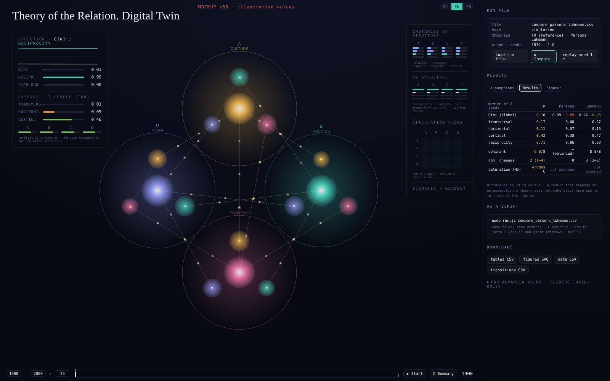
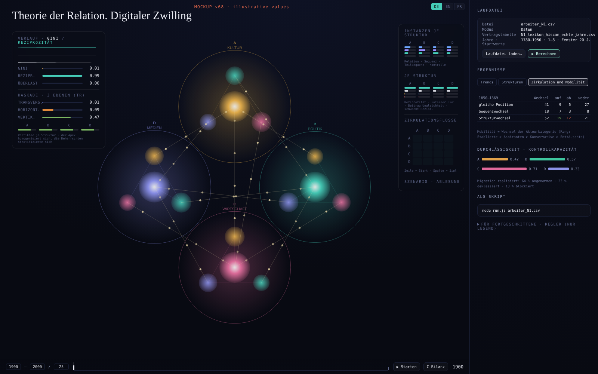

#+TITLE: v68 — Runs from files, results that answer questions
#+SUBTITLE: Specification for review (branch v68; not part of the documentation yet)
#+OPTIONS: toc:t num:t ^:nil
#+LANGUAGE: en

* Purpose

The twin is used by students who do not move the sliders and are not expected to. What they need is (1) to prepare a run in files, (2) to see results that answer their questions, and (3) to see that what the interface does is a script that runs the same way on the command line.

v68 changes *how the twin is used*, not *what it computes*. The mechanics (=step()=, the mechanisms, the profiles, the contract table) are not touched. With the same files, v68 computes exactly what v67 computes on its deterministic path (Σ Summary, =run.js=).

* Principles

1. *A run is defined by files.* A run file names the mode, the theory profiles or the contract table, the time axis, the seeds and, if wanted, a stimulus. The profiles and the contract table keep their current formats.
2. *One computation, two front ends.* The interface and =node run.js run.csv= read the same files and call the same function. The run is computed with fixed steps (as Σ Summary and the headless scripts do today); the animation then replays the recorded states.
   - Reason: the live animation (▶ Start) advances by the real frame time of the browser times the animation speed. It is not reproducible today, even with a fixed seed. Replaying a computed run makes interface and command line identical.
3. *Several seeds by default.* Every result is reported over the seeds of the run (median and range). Chapter 12 showed why: in variant (a), whether the economy escapes satellisation around 1815 depends on the seed (3 of 8).
4. *The TR default is the reference in every result.* It is computed with every run, whether or not the run file names it.
5. *Inputs in English, German or French.* Keys and values of the run file are accepted in the three languages (as slider names in profiles already are). Output tables and figures follow the interface language.

* The run file

A CSV with two columns, key and value (more values in further columns where a key takes several). Lines beginning with =#= are comments. Keys are case-insensitive; accents optional.

** Keys

| Key (en)    | de             | fr            | Value                                                                    | Mode   |
|-------------+----------------+---------------+--------------------------------------------------------------------------+--------|
| mode        | modus          | mode          | =simulation= / =data= (=Simulation=, =Daten= / =simulation=, =données=)  | both   |
| profile     | profil         | profil        | a profile CSV; the key may repeat (one row per theory)                   | sim    |
| contracts   | vertragstabelle | contrats     | a contract table CSV                                                     | data   |
| categories  | kategorien     | categories    | rule for empty categories: =uniform= / =composition= / =empty=           | data   |
| stepped     | stufen         | paliers       | =yes= / =no= (stepped interpolation of the cohort)                       | data   |
| start, end  | beginn, ende   | debut, fin    | years of the time axis (data: default = first and last year of the table) | both   |
| steps       | schritte       | pas           | number of steps (simulation, instead of years)                           | sim    |
| seeds       | startwerte     | graines       | =1-8= or =1,4,7=                                                         | both   |
| stimulus    | reiz           | stimulus      | structure, direction, duration, strength, begin: =B,weaken,300,2.6,1819= | sim    |
| trend window | trendfenster  | fenetre       | years per trend period (default 20)                                      | data   |
| output      | ausgabe        | sortie        | folder for tables and figures (command line)                             | both   |

Example (simulation):

#+begin_example
# compare Parsons and Luhmann with the TR
mode,simulation
profile,profiles/profil_Parsons.csv
profile,profiles/profil_Luhmann.csv
steps,1819
seeds,1-8
#+end_example

Example (data):

#+begin_example
modus,Daten
vertragstabelle,contracts/N1_lexikon_hiscam_echte_jahre.csv
kategorien,uniform
startwerte,1-8
trendfenster,20
#+end_example

In the interface: *Load run file* (plus the files it names). In a terminal, from the twin folder: =node run.js run.csv=.

* Results

** Simulation mode: what do the assumptions of the theories change?

*Table 1 — Assumptions.* Rows: the thirteen sliders, the four chains, the mechanisms M1–M6 (and the saturation time). Columns: the TR default (reference), then each theory of the run file. A cell shows the value the theory declares; an assumption the theory does not make is shown as /not assumed/.

*Table 2 — Results.* For each theory and the TR, over the seeds (median, range):
- inequality: global Gini, and the three levels (transversal, horizontal, vertical);
- reciprocity;
- sizes of A, B, C, D at the end; dominant structure (share of seeds);
- changes of domination (number, and the step at which the first domination ends);
- with a stimulus: whether the run returns, settles or keeps moving (as in the Reizschwelle step).
Each value is also shown as the difference to the TR.

*Figures.* One figure per result group, the theories next to the TR. A theory appears in a figure only where the result is comparable: a result that depends on an assumption the theory does not make (e.g. saturation without M5) is kept in Table 2, marked, and left out of the figure.

** Data mode: what does the cohort show over time?

*1. Trends.* For each trend period (default 20 years) and for the whole period: direction and size of the change of inequality (three levels), reciprocity and the sizes of the structures — for the whole relational space and per structure. A trend is marked when it is larger than the spread between seeds. Table and figure; the yearly series are exported so that students can compute trends themselves (another window, another measure).

*2. Detail per structure.* For A, B, C, D: size, reciprocity, internal Gini, vertical inequality, instances (relation, sequence, sub-sequence, control) and control capacity, as series and per trend period.

*3. Circulation and mobility.*
- /Circulation/ is every movement of an actor between positions: between sequences of the same structure, or between structures, and also a change of stage without a change of position. Counted from the transitions of the contract table and the migrations of the run, per period: same position · change of sequence · change of structure (as in chapter 12, section 12.7), and as a 4×4 matrix of flows between structures.
- /Mobility/ is the reading of a circulation as ascending, descending or neither, from the change of the actor category at that transition, whether the actor stays in the sequence, changes the sequence or changes the structure. Cross-table: kind of circulation × direction of mobility, per period (the chapter 11/12 finding that a change of structure is not necessarily an ascent becomes visible directly).
- /Permeability/: next to circulation and mobility, the control capacity of the instances per structure and per sequence, and the migration actually realised (accepted, downgraded, blocked).

The status of the actor categories in the run is the twin's existing order (used for vertical inequality): established 3 > aspirants 2 > conservatives 1 > disappointed 0. A transition to a higher rank is ascending, to a lower rank descending, an equal rank neither. *To be confirmed — see open decisions.*

HISCAM plays no role in the twin's results: it is one way (used in chapters 11 and 12) to classify the material into the contract table; other material is classified by other means (e.g. topic models).

* Interface

Mockups (right column only; values illustrative):  · . The bottom timeline becomes the replay control of the computed run.

- *Left and centre (unchanged):* the four structures, the evolution of Gini and reciprocity, the inequality cascade, instances, circulation flows.
- *Right column (new):*
  1. *Run file* — load; shows mode, files, years or steps, seeds; button *Compute*; then the animation replays seed 1 (selector for the others).
  2. *Results* — tabs: simulation: Assumptions · Results · Figures; data: Trends · Structures · Circulation and mobility.
  3. *As a script* — the command for the terminal (Windows, macOS, Linux), the run file to download, and how to install Node.js and jsdom.
  4. *Downloads* — tables (CSV) and figures (SVG/PNG) of the results, data CSV, transitions CSV.
  5. *For advanced users* (collapsed, read-only) — the thirteen sliders with the values of the loaded profile, the chains and the mechanisms. They show what else can be coded; they cannot be moved.
- *Removed from the interface* (code kept): population data import, keyframe population sliders, timeline keyframe editing, slider profile and cohort import as separate fields (now via the run file), the stimulus panel (now a run-file key), the what-if scenario panel (now the trends).
- Language switch DE/EN/FR as now.

* Command line

- =package.json= in the repository: =npm install= installs jsdom once.
- =node run.js run.csv= writes the same tables and figures as the interface into the output folder.
- Installation of Node.js (shown in the interface and in document 4):
  - Windows: installer (LTS) from nodejs.org, or =winget install OpenJS.NodeJS.LTS=;
  - macOS: installer (LTS) from nodejs.org, or =brew install node=;
  - then in the twin folder: =npm install=.
  On pool computers the installation may need administrator rights.
- The existing scripts (=run_steps.js=, =batch.js=, =sweep.js=, =metrics.js=, …) stay.

* Tests

- With the same files, the results of v68 equal those of v67's deterministic path (Σ Summary / =run.js=), bit for bit, for all profiles in =simulation-mode/profiles/= and the contract tables of chapters 11 and 12.
- The interface (driven in a browser) and =node run.js= give identical tables for a simulation and a data run file.
- Run files in English, German and French give the same run.

* Documentation and book

- Document 3 (Usage) rewritten around run files; document 4 (Headless runs) gains =run.js run.csv= and the installation; document 6 records v68.
- The book (chapters 1 and 3 mention the interface) is checked when the branch is merged after publication.

* Open decisions

1. *Direction of mobility.* Is the rank order established > aspirants > conservatives > disappointed the right basis for ascending/descending, or does the theory read some changes otherwise (e.g. conservatives → aspirants)? If needed, a 4×4 table of directions can be fixed instead of the rank.
2. *Undeclared sliders.* A profile that does not set a slider runs with the TR default for it. Table 1 shows /not assumed/; should the results of such a theory count as comparable on that point (it runs with the TR value), or be marked?
3. *Simulation mode results:* are the results listed in Table 2 the ones students need, or is something missing (e.g. the satellisation of each structure, the sequence regimes)?
4. *Trend window:* 20 years as default — and should the trend also be given per decade for the data of chapters 11/12?
